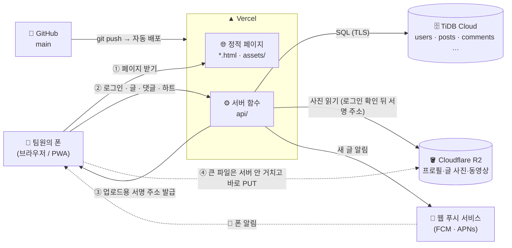

# HR T | 니핑 프로젝트 (가칭)

> HR 떡밥 리텐션 프로젝트

원티드 HR 미드필더 8기 **T조** 스터디의 팀 프로젝트입니다.
팀원들이 글을 쓰고, 사진·동영상을 붙이고, 댓글과 하트로 서로 반응하는 **모바일 전용 아티클 사이트**입니다.
(12월 최종발표 주제와 이어지는 «T조 자동 아티클 생성 & 업로드» 아이디어에서 출발했습니다.)

**https://tnieping.com**

## 무엇을 할 수 있나

- **초대장으로만 가입** — 팀원이 초대 링크를 만들어 공유합니다. 이메일 + 비밀번호로 로그인합니다.
- **아티클** — 글쓰기, 분류, 사진·동영상 첨부(글 하나에 최대 10개), 댓글·답글, 하트. «AI와 함께 썼어요» 표시도 가능합니다.
- **T조 소개** — 팀원 카드와 프로필(커버·프로필 사진).
- **알림** — 앱 안 알림, 새 글이 올라오면 폰으로 오는 웹 푸시.
- **홈 화면에 추가(PWA)** — 앱처럼 설치해서 쓸 수 있습니다.

## 아키텍처

프레임워크 없이 정적 HTML + 바닐라 JS, 서버는 Vercel 함수입니다.



| | 역할 | 사용 | 메모 |
|---|---|---|---|
| 📱 | 화면 | 정적 HTML·CSS·JS (`*.html`, `assets/`) | 폰 폭 한 칸, 홈 화면에 추가(PWA) |
| ⚙️ | 서버 | Vercel Functions (`api/`) | 서비스별로 파일을 나눔 |
| 🗄️ | DB | TiDB Cloud (MySQL 호환) | 비밀번호는 scrypt 해시, 세션은 서명된 쿠키 |
| 🪣 | 파일 저장 | Cloudflare R2 (비공개 버킷) | 동영상 300MB 까지, 브라우저가 직접 업로드 |
| 🔔 | 푸시 | 웹 푸시 (VAPID) | 새 글이 올라오면 알림을 켠 기기로 |
| 🚀 | 배포 | GitHub → Vercel 자동 배포 | `main` 에 푸시하면 끝 |

**왜 파일은 서버를 안 거치나?** Vercel 함수는 요청 본문이 4.5MB 까지라 300MB 동영상을 못 받습니다.
그래서 서버는 «이 크기·형식만 올릴 수 있는 임시 주소»만 발급하고, 파일은 브라우저가 R2 로 곧장 올립니다.

## 폴더

```
api/        서버 함수 (로그인, 글, 댓글, 좋아요, 미디어, 알림, 푸시 …)
assets/     공통 스타일·스크립트·아이콘
scripts/    DB 만들기, 초대장 발급, 로컬 서버, 연결 점검
*.html      페이지 (홈, 아티클, 글쓰기, T조 소개, 마이페이지, 가입)
```

## 로컬에서 돌려 보기

```bash
git config core.hooksPath .githooks   # 커밋 전 비밀값 검사 켜기 (clone 한 뒤 한 번)
npm install
cp .env.example .env     # 값은 관리자가 전달한 «테스트 환경» 값으로 채운다 (.env 는 커밋 금지)
node scripts/dev.js      # http://127.0.0.1:8791
```

`.env` 는 **테스트 DB·테스트 버킷**에만 붙어야 합니다(`APP_ENV=test`, 없으면 서버가 실행을 거부합니다).
운영 값은 팀원에게 전달하지 않습니다. 테스트 DB 에서는 글을 쓰고 지워도 운영에 영향이 없습니다.
테스트 DB 의 표 만들기 `python scripts/init_db.py`, 첫 가입용 초대장 `python scripts/make_invite.py`.

## 함께 만들기

1. 새 브랜치를 만든다 → 고친다 → PR 을 올린다. `main` 에 직접 푸시하지 않습니다.
2. PR 에 달리는 Vercel 미리보기 주소(테스트 DB 에 연결)를 폰으로 열어 테스트 계정으로 확인한다.
3. 관리자가 검토해 병합하면 운영 사이트(https://tnieping.com)에 반영됩니다.

AI 도구를 쓸 때의 규칙은 [AGENTS.md](AGENTS.md) 에 있습니다.

<!-- 시험 PR: 협업 흐름 확인용, 병합하지 않고 닫습니다 -->
